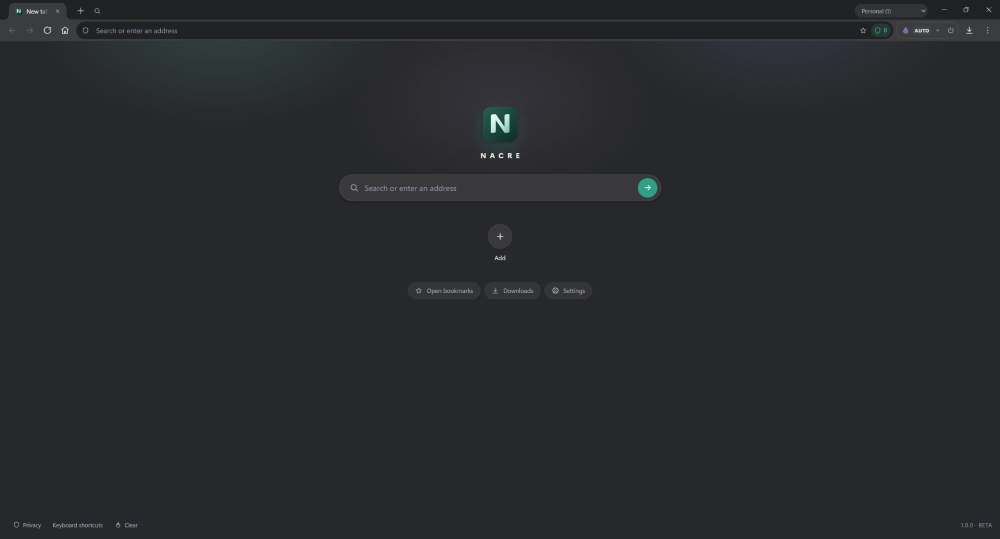
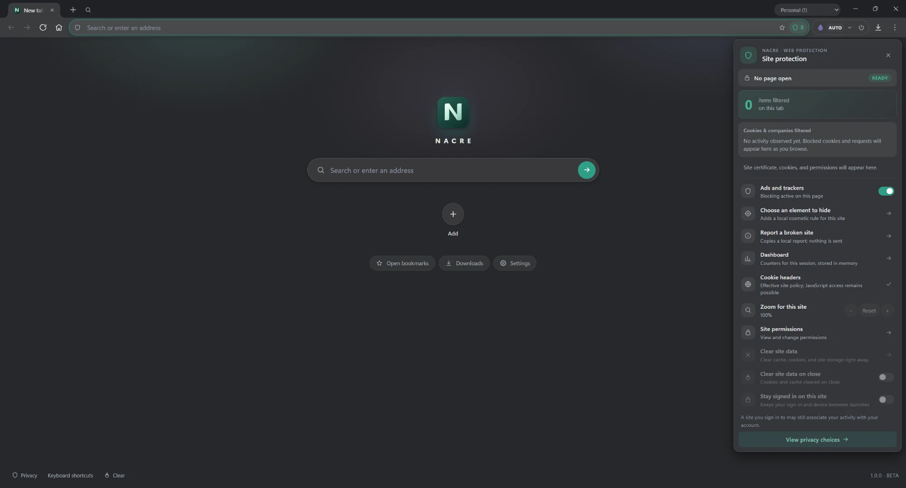
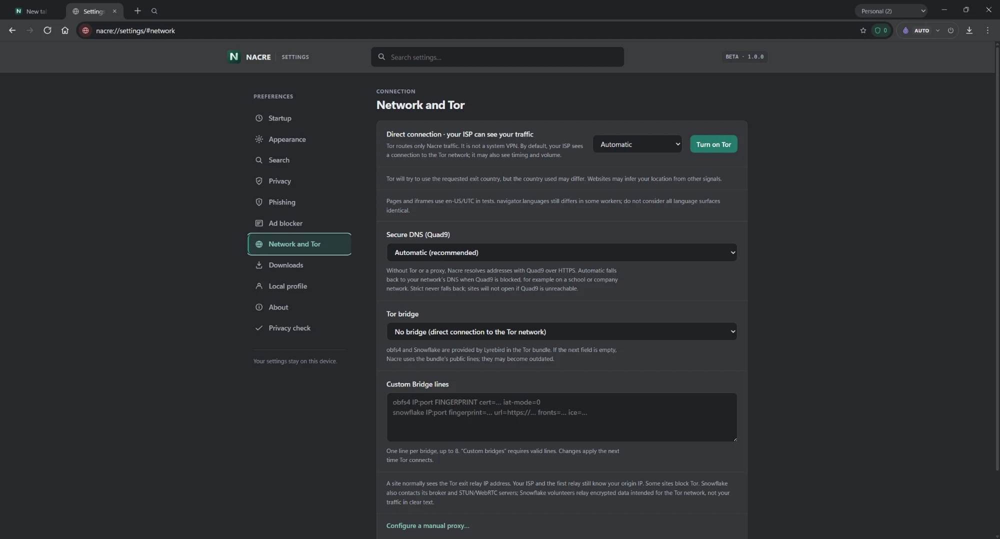
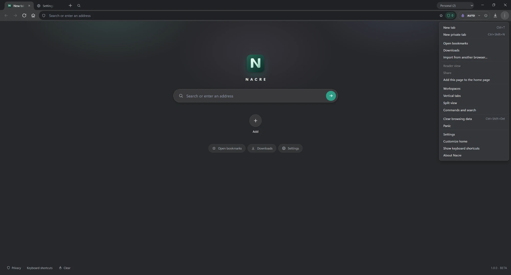

# Nacre

A privacy-focused web browser for Windows and Linux, built on Electron and Chromium.

Nacre routes your browsing through Tor by default, blocks ads and trackers, and keeps everything on your PC: no account, no sync, no telemetry.

**Status: beta (1.1.0).** It works for everyday browsing, but the Windows installer is not signed yet and some protections are partial. The Linux version is newer and less tested. Don't use it for anything where your safety depends on anonymity: use [Tor Browser](https://www.torproject.org/) for that.

https://github.com/user-attachments/assets/ee91cc40-786c-449c-a132-e4016a3b8ba4



| Site protection | Network and Tor settings | Menu |
|---|---|---|
|  |  |  |

## Features

- **Tor built in**, on by default, with bridge support. Direct mode and manual proxies are available too.
- **Ad and tracker blocking**, with per-site controls and a view of what was blocked and why.
- **Phishing warnings** from local checks and a bundled list. The addresses you visit are not sent anywhere.
- **Tracking-link cleanup**: removes tracking parameters from links.
- **Workspaces**: each one has its own separate cookies and storage.
- **Private tabs**, "forget this site when its last tab closes", and clear on quit.
- **Password-protected profiles** for settings and bookmarks.
- **Bookmark import** from Chrome, Edge, Brave, Vivaldi, Opera and Firefox, read locally.
- **20 interface languages**, plus your own if yours is missing.
- **Signed automatic updates**: Nacre checks for new versions (through Tor when Tor is on), verifies them with its own signing key and installs them when you restart.

See [PRIVACY.md](PRIVACY.md) for exactly what is stored and what goes over the network.

## Install

### Windows

Download `Nacre-Setup-1.1.0.exe` from the [releases page](https://github.com/nacrebrowser/nacre/releases) and run it. You can choose the install folder and whether Tor is on by default.

Windows will say "Windows protected your PC" because the installer is not signed yet. Click **More info**, then **Run anyway**. You can check the file against `SHA256SUMS-1.1.0.txt`:

```powershell
Get-FileHash .\Nacre-Setup-1.1.0.exe
```

A portable version is also available: unzip `Nacre-1.1.0-Portable.zip` and run `Nacre Portable.cmd`. Your data stays in the `NacreData` folder next to it.

### Linux (beta)

A `.deb` package for Ubuntu and Debian (x86-64) is on the releases page:

```bash
sha256sum nacre_1.1.0_amd64.deb
sudo apt install ./nacre_1.1.0_amd64.deb
```

Compare the hash with `SHA256SUMS-1.1.0.txt`. Nacre then appears in your applications menu. Chromium's sandbox stays on: the package installs its helper the standard way.

### Updates

From 1.1.0, Nacre checks for updates once a day:

- with Tor on, every update request goes through Tor; without Tor, Nacre asks once before contacting GitHub directly;
- an update is installed only if its signature matches the key built into Nacre, so a file replaced on GitHub would be refused;
- the Windows installer version updates itself when you restart; the portable and Linux versions tell you when a new version is out.

You can turn automatic updates off in Settings › About. Version 1.0.0 has no updater: install 1.1.0 by hand once.

## Build from source

You need Windows x64 or Linux x86-64, Node.js 24 and pnpm.

```powershell
pnpm install
pnpm start
```

`pnpm start` downloads the pinned Tor bundle on first run.

```powershell
pnpm test
pnpm run build:windows
```

The build writes the installer, the portable zip and the checksums to `dist\`. On Linux, `pnpm run build:linux` writes the `.deb` to `dist/` (it needs `ar`, from the `binutils` package).

## Documentation

- [Privacy](PRIVACY.md)
- [Security and threat model](docs/security/THREAT_MODEL.md)
- [Testing a beta](docs/TESTERS.md)
- [Translations](docs/LOCALIZATION.md)
- [Profiles](docs/LOCAL_PROFILES.md), [diagnostics](docs/DIAGNOSTICS.md), [phishing list](docs/phishing-feed.md)
- [Changelog](CHANGELOG.md)

## Code signing

Windows builds are not signed with a code-signing certificate yet. Every release ships with a `SHA256SUMS` file, so you can check that your download matches the published build (see [Install](#install)), and you can build the same version yourself (see [Build from source](#build-from-source)). Signing will be added when a certificate is available, and this section will say so. Automatic updates are verified separately, with Nacre's own update key (see [SECURITY.md](SECURITY.md)).

- Committers and reviewers: [NacreDev](https://github.com/nacrebrowser)
- Approvers: [NacreDev](https://github.com/nacrebrowser)

What Nacre stores and sends over the network is described in the [privacy policy](PRIVACY.md).

## Support Nacre

Nacre is free and has no ads or tracking. If it is useful to you, you can support its development with a [donation on PayPal](https://paypal.me/donNacre).

## License

Nacre is released under the [Mozilla Public License 2.0](LICENSE.md). Bundled components (Tor, filter lists, Electron) keep their own licenses: see [THIRD_PARTY_NOTICES.md](THIRD_PARTY_NOTICES.md).
